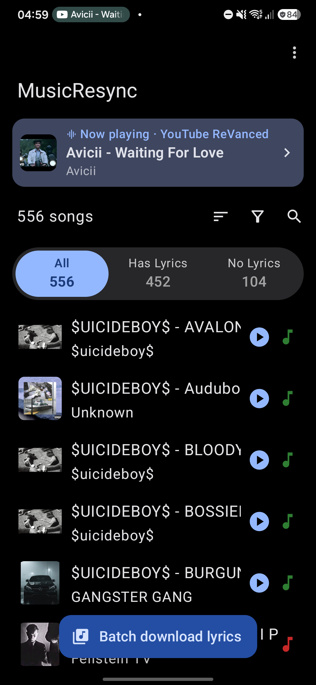
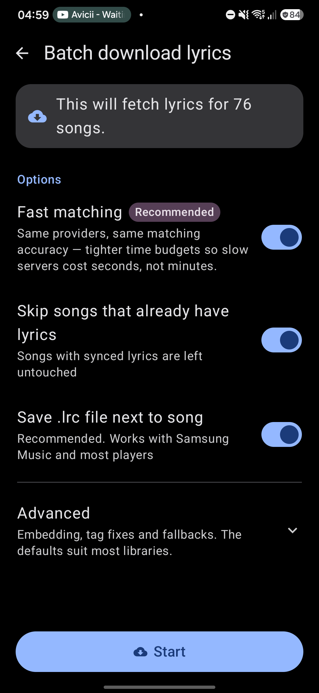
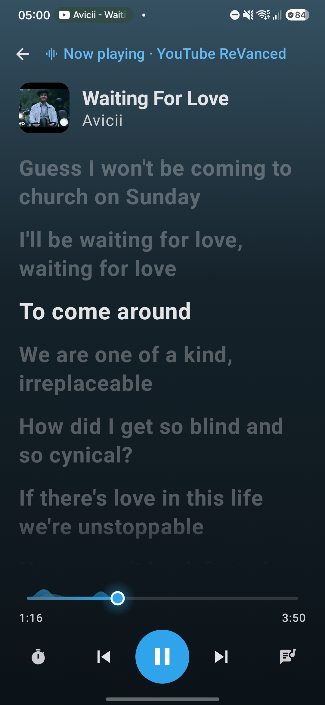

<div align="center">

# MusicResync

**Synced lyrics for your local music, even when the tags are a mess.**

[](LICENSE)


[](../../releases/latest)
[](../../releases)

&nbsp;
&nbsp;


### [Download the latest release](../../releases/latest)

</div>

---

Pick your music folder and press **Start**. MusicResync finds time-synced `.lrc` lyrics for every song and
saves them next to the file, so Samsung Music and other players show them right away. It's made for
SnapTube and YouTube rips with broken or missing tags, where other lyric apps give up.

## Features

- **Smart matching.** Reads the artist and title from the filename when the tags are wrong, strips junk like
  `(Official Video)` or `(MP3_320K)`, and checks the song length so it doesn't grab the wrong version.
- **One tap for the whole library.** Batch download goes through everything that still needs lyrics. You can
  leave it running in the background.
- **Lots of sources, no setup.** Deezer, LRCLib, LyricsPlus, BetterLyrics, NetEase, Apple Music, Spotify and
  QQ Music. No accounts or API keys. If one comes up empty, the next one is tried.
- **Strong on non-English music.** Deezer is asked first and has licensed lyrics for a lot of Balkan and other
  music the usual sources don't.
- **Live lyrics for what's playing.** A Now playing card shows lyrics for the song playing in YouTube,
  Spotify or any other app, with the current line highlighted.
- **Built-in lyrics player** with a timing slider for songs where the lyrics run a little early or late.
- **Your library, your way.** Choose which folders to scan, hide songs you never want lyrics for, and filter
  by songs with or without lyrics.
- **Fixes SnapTube lyrics files.** SnapTube's `_private.lrc` files are renamed so your player picks them up.

## Install

1. Download `MusicResync-vX.Y.Z.apk` from the [latest release](../../releases/latest) and install it.
2. Allow **All files access** when asked, so the app can read your music and save lyrics next to it.

Needs Android 5.0 or newer. It installs alongside the original SongSync, not over it.

## Build from source

Needs the Android SDK and JDK 17–21.

```bash
git clone https://github.com/DynamycSound/MusicResync
cd MusicResync
./gradlew :app:assembleDebug
```

Run the tests with `./gradlew :app:testDebugUnitTest`.

## Credits

A fork of [SongSync](https://github.com/Lambada10/SongSync) by Lambada10 and contributors. Provider
integrations are inspired by [syncedlyrics](https://github.com/moehmeni/syncedlyrics) and
[spotify-lyrics-api](https://github.com/akashrchandran/spotify-lyrics-api).

Licensed under the [GNU GPL v3](LICENSE), like the original SongSync.
